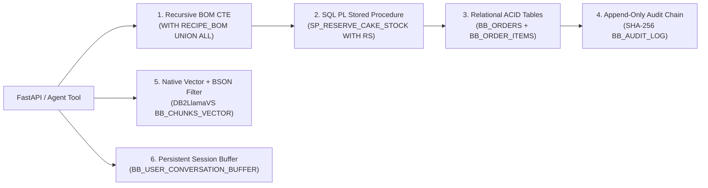

# BAKEBOX-AI: Autonomous AI Bakery Management & Customer Support
### CHOCO AI — Hybrid RAG, Multi-Level Recursive BOM & ACID Concurrency on IBM Db2 12.1

[](#testing--verification)
[](#ibm-db2-integration)
[](#rest-api--interactive-playground)
[](#security--privacy-architecture)
[](#prerequisites)

> **One-Line Pitch:** **BAKEBOX-AI (CHOCO AI)** turns **IBM Db2 LUW 12.1** into a single unified engine for AI customer guidance and ACID bakery operations—built for our 20-year family bakery (*Shri Ram Baker's*, Mathura). It combines native Db2 `VECTOR(384, FLOAT32)` similarity search + BSON metadata pushdown (`DB2LlamaVS`) with 3-Way Reciprocal Rank Fusion ($k=60$), Hinglish CRAG & Self-RAG verification, quantity-scaled Recursive Bill-of-Materials (BOM) CTE checks, `SEQ_BB_ORDER_ID` sequence allocation, `FOR UPDATE WITH RS` stock locking (`SP_RESERVE_CAKE_STOCK`), Db2-hydrated session memory, and a keyed HMAC-SHA256 hash-chained audit trail behind a hardened FastAPI API and `/demo` playground.

---

## Judge Quickstart (Verify in 60 Seconds — Zero Docker Required)

Reviewers can run all **78 offline automated tests** (`+1` opt-in live-Db2 smoke test), inspect the **30-query retrieval ablation benchmark across 25 knowledge nodes**, and test the **interactive web playground** offline without database credentials or external API keys (backed by our thread-safe, ACID snapshot-rollback PEP 249 `MockDb2Connection` and `_OfflineMockVectorStore` cosine simulator):

```bash
# 1. Enter the submission directory & install dependencies
cd submissions/bakebox-choco-ai
pip install -r requirements.txt

# 2. Run all unit, HTTP API, concurrency, security, rollback & audit tests (78 offline + 1 live-Db2 opt-in)
python -m unittest discover -s tests -v

# 3. Run the 30-query, 4-channel empirical retrieval ablation benchmark
python tests/evaluate_retrieval.py

# 4. Launch FastAPI & Interactive Judge Console
uvicorn src.api:app --reload
# Interactive Browser Playground : http://127.0.0.1:8000/demo
# OpenAPI / Swagger Docs         : http://127.0.0.1:8000/docs
```

*(Want to run against a real containerized IBM Db2 12.1 instance instead? Jump to [Running with Live IBM Db2 (Docker)](#2-running-with-live-ibm-db2-docker).)*

---

## Table of Contents
- [Evaluation Rubric Coverage Matrix](#evaluation-rubric-coverage-matrix)
- [Problem Statement](#problem-statement)
- [Solution Overview](#solution-overview)
- [IBM Db2 Integration](#ibm-db2-integration)
- [AI & Hybrid RAG Architecture](#ai--hybrid-rag-architecture)
- [Security & Privacy Architecture](#security--privacy-architecture)
- [Tech Stack](#tech-stack)
- [Project Structure](#project-structure)
- [REST API & Interactive Playground](#rest-api--interactive-playground)
- [Retrieval Quality Benchmark](#retrieval-quality-benchmark)
- [Prerequisites](#prerequisites)
- [Setup & Installation](#setup--installation)
- [Configuration](#configuration)
- [Running the Project](#running-the-project)
- [Testing & Verification](#testing--verification)
- [Screenshots & Demo](#screenshots--demo)
- [Technical Defense & Architectural FAQ](#technical-defense--architectural-faq)
- [Known Limitations & Future Roadmap](#known-limitations--future-roadmap)
- [Team Members & Credits](#team-members--credits)
- [License](#license)

---

## Evaluation Rubric Coverage Matrix

| Dimension | Weight | What Was Built & Verified | Key Files |
| :--- | :---: | :--- | :--- |
| **1. IBM Db2 Integration & Depth** | **25%** | Native `VECTOR(384, FLOAT32)` + `SYSTOOLS.BSON2JSON` predicate pushdown (`DB2LlamaVS`); Quantity-Scaled Multi-Level Recursive BOM CTE (`WITH RECIPE_BOM UNION ALL`, typed `DECIMAL(10, 4)`); `SEQ_BB_ORDER_ID` collision-free sequence; SQL PL Stored Procedure `SP_RESERVE_CAKE_STOCK` (`FOR UPDATE OF stock_qty WITH RS` + `WHERE CURRENT OF`); single-UOW ACID transactions; sargable `phone_last10` B-Tree index; `V_ACTIVE_BAKERY_ORDERS` & `V_MASKED_BAKERY_ORDERS` views; `BB_USER_CONVERSATION_BUFFER` hydration; `BB_AUDIT_LOG`. | [`src/db.py`](src/db.py)<br>[`src/ingest.py`](src/ingest.py)<br>[`src/order_engine.py`](src/order_engine.py)<br>[`src/vector_store.py`](src/vector_store.py) |
| **2. Innovation & Real-World Impact** | **20%** | Engineered for a 20-year regional Mathura bakery (*Shri Ram Baker's*, Holigate & Gosna branches) with a **15-SKU (`25`-node) multi-flavor catalog**, eliminating late-night lost sales, raw-material blind spots, and overselling; Hinglish CRAG query expansion + Self-RAG factual safety; one-click browser playground at `GET /demo`. | [`src/retriever.py`](src/retriever.py)<br>[`src/query_engine.py`](src/query_engine.py)<br>[`src/demo_ui.py`](src/demo_ui.py) |
| **3. Technical Architecture & AI** | **15%** | Modular 9-file pipeline; 3-Way Reciprocal Rank Fusion ($k=60$) with cached 384-d embeddings; **Google Gemini 1.5 Flash** (`gemini-1.5-flash` via `google-genai`) with 5 request-scoped agentic tools (`AutomaticFunctionCallingConfig`, zero cross-session race leaks), Db2 session cache hydration on miss, and deterministic `--no-llm` fallback (including BOM chat queries); matching [`architecture.md`](architecture.md). | [`src/query_engine.py`](src/query_engine.py)<br>[`src/api.py`](src/api.py)<br>[`architecture.md`](architecture.md) |
| **4. Security** | **15%** | Zero committed secrets; submission-local `.env` isolation; least-privilege Db2 roles & append-only `BB_AUDIT_LOG` ([`sql/least_privilege_setup.sql`](sql/least_privilege_setup.sql)); parameterized SQL + `validate_doc_id()` driver SQLi guard; `X-Operator-Key` admin route guard; keyed **HMAC-SHA256** audit log sealing UTC `_audit_ts`; 2FA phone auth + IP-partitioned `OrderAuthRateLimiter` + PII masking; NFKC + zero-width prompt guardrails + XML delimiters + HTTP 400 validation + output secret/XSS scrubbing; hardened CORS. | [`src/security.py`](src/security.py)<br>[`sql/least_privilege_setup.sql`](sql/least_privilege_setup.sql)<br>[`.env.example`](.env.example) |
| **5. Reproducibility & Code Quality** | **15%** | **78 offline tests passing + 1 opt-in live-Db2 smoke test** (`79` total across `7` suites, `0 errors, 0 failures`) covering concurrency, sequence allocation, scaled BOM, ACID rollback injection, Gemini tool schemas, HTTP `TestClient`, `X-Operator-Key`, IP rate limits, and audit integrity; 30-query ablation benchmark; Docker Db2 setup ([`docker-compose.yml`](docker-compose.yml)); Python 3.10–3.14 [`requirements.txt`](requirements.txt). | [`tests/`](tests/)<br>[`docker-compose.yml`](docker-compose.yml)<br>[`requirements.txt`](requirements.txt) |
| **6. Documentation & Presentation** | **10%** | Complete [`submission.json`](submission.json), MIT [`LICENSE`](LICENSE), [`THIRD_PARTY_NOTICES.md`](THIRD_PARTY_NOTICES.md), 11 production screenshots ([`docs/screenshots/`](docs/screenshots/README.md)), video demo, and clean commit scope inside `submissions/bakebox-choco-ai/`. | [`README.md`](README.md)<br>[`submission.json`](submission.json)<br>[`THIRD_PARTY_NOTICES.md`](THIRD_PARTY_NOTICES.md) |

---

## Problem Statement

*Shri Ram Baker's* operates two kitchens in Mathura (**Bhagel Chaupal / Khatoti Kua / Holigate** and **Gosna**). Moving traditional counter orders online exposed concrete customer and operational gaps:
1. **Menu Ambiguity & Sweetness Guesswork (Customer POV):** Static product cards cannot answer personalized questions (*"Is Red Velvet overly sweet?"*, *"What is a Khoaa Eggless base vs regular eggless?"*, *"0.5kg vs 1kg servings?"*) or understand casual bilingual Hinglish queries (*"bina ande wala aadha kilo cake"*).
2. **Post-9 PM Support Drop-Off (Business POV):** Late-night celebration planners abandon orders when phone support goes offline or kitchen staff get buried answering repetitive questions (*"Wait time kya hai?"*, *"Patty garam kaise karein?"*).
3. **Overselling & Raw Ingredient Blind Spots:** Accepting the last ready cake simultaneously from two buyers creates race-condition double-booking, while accepting orders without checking multi-level raw ingredients (e.g., *Fresh Milk Solids* inside *Khoaa Base*, or *Maraschino Cherries*) causes fulfillment failures.

---

## Solution Overview

**CHOCO AI** unifies conversational AI guidance and strict relational order execution on top of IBM Db2:
* **Bilingual Discovery with Zero Cross-Category Noise:** Pushes cake, eggless dietary, and price-budget predicates directly into Db2 vector search and fuses semantic vectors with exact SKU/keyword ranking via 3-Way RRF ($k=60$).
* **Inventory & BOM Verification Before Checkout:** Checks both finished cake stock (`SP_RESERVE_CAKE_STOCK` under `WITH RS` row locks) and multi-level raw ingredient sub-assemblies (`WITH RECIPE_BOM` Recursive CTE) inside one ACID transaction.
* **Privacy-First Self-Service Tracking & Refunds:** Enforces 2FA (`order_id` + 10-digit phone), locks brute-force guesses, masks customer PII at the DB retrieval boundary, and logs every approval/failure to an immutable SHA-256 hash chain (`BB_AUDIT_LOG`).

---

## IBM Db2 Integration

BAKEBOX uses **IBM Db2 Community Edition 12.1** via official **`ibm_db` / `ibm_db_dbi`** drivers and **`llama-index-vector-stores-db2` (`DB2LlamaVS`)**:



### Schema & Database Objects Provisioned by [`src/ingest.py`](src/ingest.py)
* **Vector Table:** `BB_CHUNKS_VECTOR` (`VECTOR(384, FLOAT32)` + `metadata BLOB` queried via `SYSTOOLS.BSON2JSON` predicate pushdown).
* **Core Relational Tables & Sequence:**
  * `BB_ORDERS` (with normalized `phone_last10 VARCHAR(10)` indexed by `IDX_BB_ORDER_PHONE` for sargable O(log N) 2FA lookups) + `SEQ_BB_ORDER_ID` collision-free Order ID sequence
  * `BB_ORDER_ITEMS` (linked via `CONSTRAINT FK_BB_ORDER FOREIGN KEY (order_id) REFERENCES BB_ORDERS(order_id) ON DELETE CASCADE`, storing catalog-verified item weights)
  * `BB_CAKES`, `BB_INVENTORY`, `BB_RECIPES`, `BB_INGREDIENT_COMPONENTS` (composite PK + cascading FKs for multi-level recipes)
  * `BB_USER_CONVERSATION_BUFFER` (persists and rehydrates isolated multi-turn dialogue turns inside Db2)
  * `BB_AUDIT_LOG` (keyed HMAC-SHA256 hash-chained business ledger with sealed UTC timestamps)
* **Operational Views & Stored Procedure:**
  * `V_ACTIVE_BAKERY_ORDERS` & privacy-masked `V_MASKED_BAKERY_ORDERS`
  * `SP_RESERVE_CAKE_STOCK`: Acquires `FOR UPDATE OF stock_qty WITH RS` cursor and executes `UPDATE BB_CAKES ... WHERE CURRENT OF lock_cur`, returning `DYNAMIC RESULT SETS 1` inside the caller's Unit of Work.

### Core In-Database Execution Flow
When placing an order via `POST /api/orders` (`place_verified_order_atomic()`):
1. Runs **Quantity-Scaled Recursive BOM CTE** (`CAST(? AS DECIMAL(10, 4))` multiplier up to depth 5 across `BB_RECIPES -> BB_INGREDIENT_COMPONENTS -> BB_INVENTORY`). If any raw ingredient is short for the requested `quantity` (e.g., Cake #2 needing `0.50kg` *Maraschino Cherries* against `0.20kg` stock, or a `30x` bulk Cake #1 order exceeding `12.0kg` *Khoaa Base*), the order is rejected cleanly.
2. Executes `SP_RESERVE_CAKE_STOCK` under `WITH RS` lock (`commit=False`) to reserve inventory atomically without race overselling, then pulls the next unique ID from **`SEQ_BB_ORDER_ID`**.
3. Inserts into `BB_ORDERS` + `BB_ORDER_ITEMS` and appends `ORDER_PLACED` (keyed **HMAC-SHA256** + `_audit_ts`) to `BB_AUDIT_LOG` (`LOCK TABLE BB_AUDIT_LOG IN EXCLUSIVE MODE`), then executes a **single `conn.commit()`** (or full `conn.rollback()` on any error).

---

## AI & Hybrid RAG Architecture

```text
Customer Query ─▶ Security Guardrail (Unicode NFKC + Zero-Width Strip + Bilingual Prompt Guard)
                      │
                      ▼
       Corrective RAG (Hinglish Expansion: "bina ande" -> "Pure Veg Khoaa Eggless")
                      │
                      ▼
       3-Way Hybrid RRF (k=60) + Metadata Predicate Pushdown
         ├─ Channel 1: IBM Db2 Native Vector Search (Cosine Similarity + BSON Filter)
         ├─ Channel 2: Sparse Okapi BM25 (Exact SKU & Token Frequency Matching)
         └─ Channel 3: Sparse Scikit-Learn TF-IDF Cosine Matrix
                      │
                      ▼
       Request-Scoped Agentic Dispatcher (Gemini 1.5 Flash `gemini-1.5-flash` / Deterministic `--no-llm` Fallback)
         ├─ recommend_cakes()            -> Up to 3 verified catalog JSON cards
         ├─ track_live_order()           -> 2FA indexed Db2 lookup + PII boundary masking
         ├─ get_store_policy_or_advisory()-> Policy / Wait-Time / Tawa advisory retrieval
         ├─ check_cake_ingredients_bom() -> Live Recursive BOM CTE availability tree
         └─ place_verified_order()       -> Single-UOW Atomic Order + Audit Block
                      │
                      ▼
       Self-RAG Fact Verifier & Output Scrubber (Dry Tawa Rule + Credential/XSS Redaction)
```

* **Gemini 1.5 Flash (`google-genai` SDK) + Request Isolation:** Tool callables are created per request via `_build_request_tools(call_state, session_id)` inside [`src/query_engine.py`](src/query_engine.py) with explicit `AutomaticFunctionCallingConfig`, preventing concurrent user sessions from overwriting each other's recommendations or order records.
* **Db2 Session Continuity & Deterministic Parity:** Clearing RAM or restarting workers rehydrates turns cleanly from `BB_USER_CONVERSATION_BUFFER`, and running with `--no-llm` or without `GEMINI_API_KEY` routes recommendation, BOM availability (`check_cake_ingredients_bom`), policy, and tracking tools deterministically.

---

## Security & Privacy Architecture

1. **Workspace-Isolated Configuration & Zero Secrets:** [`src/db.py`](src/db.py) loads only `submissions/bakebox-choco-ai/.env` (preventing unintended parent-folder `.env` inheritance), resolves Db2 credentials and `AUDIT_HMAC_SECRET` / `OPERATOR_API_KEY` on-demand, and masks logs (`PWD=********`).
2. **Least-Privilege Db2 RBAC ([`sql/least_privilege_setup.sql`](sql/least_privilege_setup.sql)):** Separates `BAKEBOX_READER_ROLE` (catalog tables + `V_MASKED_BAKERY_ORDERS` only) from `BAKEBOX_APP_ROLE` (operational DML, `USAGE ON SEQUENCE SEQ_BB_ORDER_ID`, `SP_RESERVE_CAKE_STOCK`, and `SELECT, INSERT` append-only on `BB_AUDIT_LOG` without `UPDATE`/`DELETE`).
3. **Parameterized SQL & Third-Party Driver Hardening:** All database queries use strict `?` parameter markers and sargable `phone_last10` equality. [`validate_doc_id()`](src/security.py) enforces strict identifier regex before calling upstream `DB2LlamaVS.delete()`, blocking f-string SQL injection cleanly during idempotent re-ingestion.
4. **Operator Auth Guard & Keyed HMAC-SHA256 Audit Chain:** Setting `OPERATOR_API_KEY` enforces constant-time `X-Operator-Key` validation (`401` on unauthorized access) for `/api/orders/masked-summary` and `/api/audit/verify`; [`append_audit_log()`](src/order_engine.py) seals a UTC `_audit_ts` timestamp inside each keyed HMAC-SHA256 block.
5. **IP-Partitioned 2FA Rate Limiter & PII Masking:** Both tracking and refund endpoints enforce `order_id` + 10-digit registered mobile verification, partition brute-force lockouts by `(client_ip, order_id)` after 5 mismatches (stopping attacker-induced lockout of real buyers), log `REFUND_AUTH_FAILED` into `BB_AUDIT_LOG`, and mask customer PII (`R**** S*****`, `+91 ******3210`, `***, Mathura, UP (Confidential)`).
6. **Bilingual Prompt Guardrails, HTTP 400 Validation & Output Scrubbing:** [`src/security.py`](src/security.py) normalizes Unicode (`NFKC`), strips invisible zero-width characters, blocks English/Hinglish jailbreaks and DDL SQL payloads (`HTTP 400` via `@app.exception_handler(ValueError)`), wraps untrusted text in `<customer_input>` / `<conversation_history>` XML barriers, and strips API keys or `<script>` tags from responses.

---

## Tech Stack

* **Backend & API:** Python 3.10–3.14, FastAPI, Pydantic v2, Uvicorn
* **Database & Connectors:** IBM Db2 LUW 12.1 (`icr.io/db2_community/db2:12.1.2.0`), `ibm_db`, `ibm_db_dbi`, `llama-index-vector-stores-db2` (`DB2LlamaVS`)
* **AI, RAG & Embeddings:** LlamaIndex (`llama-index-core`), `fastembed` (`BAAI/bge-small-en-v1.5`, 384-d local embeddings), `scikit-learn` (TF-IDF), `numpy`, Okapi BM25, Google Gemini 1.5 Flash (`gemini-1.5-flash`, `google-genai`)
* **Testing & Tooling:** `unittest`, `pytest`, `httpx` (`TestClient`), Docker Compose

---

## Project Structure

```text
submissions/bakebox-choco-ai/
├── .env.example                 # Configuration template (no real credentials)
├── LICENSE                      # MIT License
├── THIRD_PARTY_NOTICES.md       # Package and embedding model license declarations
├── docker-compose.yml           # Local IBM Db2 Community Edition 12.1.2.0 container
├── requirements.txt             # Python 3.10-3.14 compatible dependencies
├── submission.json              # Hackathon metadata & Db2 feature inventory
├── README.md                    # Complete setup, engineering & verification guide
├── architecture.md              # Full DDL schemas, Mermaid flows, RRF & SHA-256 specs
├── data/
│   ├── sample_catalog.json      # 15 curated Mathura SKUs (Red Velvet, Truffle, Strawberry, Butterscotch, Patties)
│   └── sample_orders.json       # Seed orders (#1002 BAKING, #1104 CONFIRMED)
├── sql/
│   └── least_privilege_setup.sql# BAKEBOX_READER_ROLE, BAKEBOX_APP_ROLE, SEQ_BB_ORDER_ID & audit privileges
├── src/
│   ├── api.py                   # FastAPI REST endpoints, X-Operator-Key guard, HTTP 400 & CORS hardening
│   ├── db.py                    # Db2 connections, single-UOW sessions, sequence & MockDb2 engine
│   ├── demo_ui.py               # Self-contained HTML/JS playground served at GET /demo
│   ├── ingest.py                # Idempotent DDL, SQL PL SP, sequence, views, seeding & 25-node vectors
│   ├── order_engine.py          # Quantity-scaled BOM CTE, WITH RS lock, HMAC-SHA256 audit & sequence order IDs
│   ├── query_engine.py          # Agentic tool dispatcher, google-genai, Db2 hydration, Self-RAG & sessions
│   ├── retriever.py             # 3-Way Hybrid RRF, Hinglish CRAG & cached 384-d embeddings
│   ├── security.py              # NFKC prompt guard, doc_id/session validators, PII & IP+order rate limiter
│   └── vector_store.py          # Dual-mode DB2LlamaVS + offline cosine filter simulator
├── tests/
│   ├── evaluate_retrieval.py    # 30-query, 4-channel empirical ablation benchmark
│   ├── test_audit_chain.py      # HMAC-SHA256 hash chain, tamper & 16-thread concurrency tests
│   ├── test_guardrails_and_api.py# Guardrails, Self-RAG, Gemini schemas, operator key, IP lockout & HTTP tests
│   ├── test_live_db2_smoke.py   # Opt-in live IBM Db2 container integration verification
│   ├── test_order_concurrency.py# Multi-thread stock race, quantity-scaled BOM CTE & sequence/rollback tests
│   ├── test_retrieval.py        # RRF, BM25, Db2 buffer hydration & 2FA masking tests
│   ├── test_rrf_fusion.py       # Mathematical RRF rank decay & BM25 saturation tests
│   └── test_session_memory.py   # Multi-tenant isolation, TTL eviction & concurrent threads
└── docs/screenshots/            # Prototype UI & IBM Db2 VS Code proof screenshots + test traces
```

---

## REST API & Interactive Playground

Start FastAPI via `uvicorn src.api:app --reload` and open **`http://127.0.0.1:8000/demo`** (or **`/docs`** for Swagger UI):

| Method & Endpoint | Capability Exercised | IBM Db2 Feature |
|---|---|---|
| `GET /` & `GET /api/health` | Health status, live/mock mode, indexed count, audit integrity | Connection health & `verify_audit_chain` |
| `GET /demo` | Interactive browser engineering console (zero external JS build) | Exercises all REST endpoints live |
| `POST /api/chat` | Bilingual CHOCO AI chat, guardrails, Self-RAG & buffer persistence | `BB_CHUNKS_VECTOR` + `BB_USER_CONVERSATION_BUFFER` |
| `GET /api/cakes/search` | Hybrid catalog search (`eggless_only`, `max_price` budget filter) | 3-Way RRF + BSON metadata pushdown |
| `GET /api/cakes/{cake_id}/availability` | Real-time ingredient & sub-assembly availability breakdown | Recursive `RECIPE_BOM` CTE |
| `POST /api/orders` | End-to-end atomic order placement | BOM + `SP_RESERVE_CAKE_STOCK` + `BB_ORDERS` + `BB_AUDIT_LOG` |
| `GET /api/orders/masked-summary` | Privacy-safe support dashboard order summary (supports `X-Operator-Key`) | `V_MASKED_BAKERY_ORDERS` view |
| `GET /api/orders/{order_id}` | 2FA phone-verified live order & item tracking | Sargable `IDX_BB_ORDER_PHONE` + `BB_ORDER_ITEMS` |
| `POST /api/orders/{order_id}/refund` | Phone-authenticated Happiness Guarantee refund evaluation | Single-UOW `UPDATE` + `BB_AUDIT_LOG` |
| `GET /api/audit/verify` | Mathematical verification of entire cryptographic audit log (supports `X-Operator-Key`) | `BB_AUDIT_LOG` HMAC-SHA256 chain traversal |

---

## Retrieval Quality Benchmark

Measured directly via `python tests/evaluate_retrieval.py` across **30 curated queries** (10 semantic cravings, 8 exact SKU/product title lookups, 6 Hinglish & dietary queries, 6 store policy/advisory queries) evaluated over the full **25-node catalog + policy corpus** with metadata pushdown:

| Retrieval Channel Configuration | Hit @ 1 | Hit @ 3 | MRR | Avg Latency (CPU) | Notes |
| :--- | :---: | :---: | :---: | :---: | :--- |
| **Dense Vector Only** (`BAAI/bge-small-en-v1.5`) | 63.3% | 90.0% | 0.76 | ~25.2 ms | Strong semantic recall across paraphrases; misses exact SKUs (`BB-RED-02-1kg`). |
| **Sparse BM25 Only** (Okapi BM25) | 76.7% | 86.7% | 0.81 | < 1 ms | Fast exact token/SKU lookup; drops when overlapping bakery terms dilute TF. |
| **Sparse TF-IDF Only** (Scikit-Learn) | 76.7% | 96.7% | 0.86 | ~3.4 ms | Strong n-gram precision across catalog chunks, slightly weaker on vernacular synonyms. |
| **3-Way Hybrid RRF ($k=60$) + Hinglish CRAG** | **83.3%** | **96.7%** | **0.89** | **~52.5 ms** | **Strictly outperforms every single individual channel on both Hit@1 (`83.3%`) and MRR (`0.89`) across semantic, SKU, Hinglish & policy queries.** |

---

## Prerequisites

* Python `>= 3.10` (verified on Python `3.10`–`3.14`)
* `pip`
* Optional for live DB mode: Docker (IBM Db2 Community Edition `12.1.2.0`)
* Optional for generative Hinglish responses: `GEMINI_API_KEY` (leave unset or pass `--no-llm` for deterministic mode)

---

## Setup & Installation

```bash
cd submissions/bakebox-choco-ai
python -m venv .venv
# Linux/macOS: source .venv/bin/activate
# Windows:     .venv\Scripts\activate
pip install -r requirements.txt
```

---

## Configuration

Copy `.env.example` to `.env` inside `submissions/bakebox-choco-ai/` before connecting a live IBM Db2 container or Gemini key:

```bash
cp .env.example .env
```

Key environment variables (placeholders only in [`.env.example`](.env.example)):

```env
DB2_HOST=127.0.0.1
DB2_PORT=50000
DB2_DATABASE=IBMDB201
DB2_USER=your_least_privilege_db2_user
DB2_PASSWORD=your_db2_password_here
DB2_FORCE_MOCK=false

EMBEDDING_MODEL_NAME=BAAI/bge-small-en-v1.5
EMBEDDING_DIM=384
ALLOWED_ORIGINS=http://localhost:3000,http://127.0.0.1:8000

GEMINI_MODEL=gemini-1.5-flash
GEMINI_API_KEY=your_gemini_api_key_here

OPERATOR_API_KEY=your_operator_api_key_here
AUDIT_HMAC_SECRET=your_audit_hmac_secret_here
```

> **Security Hygiene:** Never commit `.env` or production database passwords to Git.

---

## Running the Project

### 1. Offline Interactive Mode (Zero Setup)
```bash
cd submissions/bakebox-choco-ai

# Run deterministic multi-session agent demo
python src/query_engine.py --no-llm

# Launch FastAPI server + /demo web console
uvicorn src.api:app --reload
```

### 2. Running with Live IBM Db2 (Docker)
```bash
cd submissions/bakebox-choco-ai
cp .env.example .env
# Edit .env: set real DB2_USER, strong DB2_PASSWORD, and DB2_FORCE_MOCK=false

# Start IBM Db2 Community Edition 12.1.2.0
docker compose up -d

# Wait for healthy container state (~60-90s initial bootstrap), then create tables, SP, views & vectors
python src/ingest.py

# Apply least-privilege Db2 roles & append-only audit permissions as SECADM:
# db2 -tvf sql/least_privilege_setup.sql

# Launch production API connected to live IBM Db2
uvicorn src.api:app --reload
```

---

## Testing & Verification

Run the official repository validator from the repository root, plus all unit/API tests (`78` offline + `1` opt-in live-Db2 smoke test) and the 30-query benchmark:

```bash
# From repo root:
python scripts/validate_submission.py submissions/bakebox-choco-ai

# From submissions/bakebox-choco-ai:
python -m unittest discover -s tests -v
python tests/evaluate_retrieval.py
```

**Observed Output Summary:**
* `scripts/validate_submission.py`: `ALL VALIDATION CHECKS PASSED.`
* `python -m unittest discover -s tests -v`: `Ran 79 tests in ~46s — OK (skipped=1)` (`78` offline tests passed with `0` failures/`0` errors; `1` opt-in live-Db2 smoke test skipped cleanly when `.env` credentials are unset)
* `python tests/evaluate_retrieval.py`: `[PASSED] Empirical 4-channel ablation benchmark verified strictly against ground-truth IDs!` (`83.3% Hit@1`, `96.7% Hit@3`, `0.89 MRR` on 25 knowledge nodes — strictly beating all individual channels)

---

## Screenshots & Demo

* **Video Walkthrough (YouTube):** [https://youtu.be/NLrRq6FX358?si=oZM-EGpaBt4AOSVM](https://youtu.be/NLrRq6FX358?si=oZM-EGpaBt4AOSVM)
* **LinkedIn Post:** [https://lnkd.in/p/gtXgu6wq](https://lnkd.in/p/gtXgu6wq)
* **Full-Stack Storefront Repository (React 18 + FastAPI):** [https://github.com/AYUSHDHANGAR/BAKE_BOX--AI-ASSISTENT-FOR-BAKERY](https://github.com/AYUSHDHANGAR/BAKE_BOX--AI-ASSISTENT-FOR-BAKERY)
* **Detailed Screenshot Traces:** [`docs/screenshots/README.md`](docs/screenshots/README.md)

| Proof Area | Preview | Verification Summary |
|---|---|---|
| **IBM Db2 Live Tables & Vectors** |  | Active VS Code Db2 extension connected to `localhost@IBMDB201` displaying `BB_*` tables and vector embeddings. |
| **Storefront & Multi-Branch Catalog** |  | Mathura storefront displaying Holigate/Gosna branch indicators, 3–4h prep badges, and pure-veg markers. |
| **Contextual "Ask CHOCO"** |  | 1-click SKU consultation passing exact catalog metadata into CHOCO AI context. |
| **Master Baker Advisory** |  | Bilingual Hinglish response detailing Khoaa eggless customization, pricing, and fresh-baking policy. |
| **Live Order Tracking** |  | Real-time Db2 status lookup (`CONFIRMED` $\rightarrow$ `BAKING` $\rightarrow$ `DELIVERED`) with dispatch details. |
| **Happiness Guarantee & Refunds** |  | Automated policy resolution backed by Db2 policy retrieval and `BB_AUDIT_LOG`. |
| **RBAC Authentication** |  | Role separation across Customer, Store Operator, and Super Admin workflows. |

---

## Technical Defense & Architectural FAQ

* **Q1: Why keep `submissions/bakebox-choco-ai/` separate from the full React frontend repository?**  
  In strict compliance with IBM Db2 TechX PR rules, the submission folder contains only self-contained backend AI/Db2 services, SQL RBAC scripts, and 79 offline/live tests (`78` offline + `1` opt-in live Db2 smoke test)—never modifying repo root configs or peer submissions. Reviewers can test interactive UI workflows locally at `/demo` or watch the React storefront live in the [YouTube Demo](https://youtu.be/NLrRq6FX358?si=oZM-EGpaBt4AOSVM).
* **Q2: How do you ensure offline mock support does not mask real database failures?**  
  `is_live_db2_available()` only enables `MockDb2Connection` when credentials are omitted/placeholder or `DB2_FORCE_MOCK=true`. Once real credentials are configured, [`src/db.py`](src/db.py) connects strictly via `ibm_db_dbi.connect(...)`, propagates authentic database exceptions, and enables `test_live_db2_smoke.py`.
* **Q3: Why normalize `phone_last10` instead of querying `RIGHT(REPLACE(customer_phone, ...), 10)`?**  
  Wrapping an indexed column in scalar functions forces a table scan (bypassing `IDX_BB_ORDER_PHONE`) and risks Db2 `SQL0138N` errors on short values. Storing normalized digits in indexed `phone_last10` preserves fast B-Tree index seeks.

---

## Known Limitations & Future Roadmap

* **Current Scope:** Lexical BM25 and TF-IDF channels operate in-memory over synchronized Db2 catalog chunks (ideal for catalogs under ~10k items), and automated CI checks default to PEP 249 `MockDb2Connection` when live Db2 credentials are absent (with `test_live_db2_smoke.py` ready to run whenever `docker-compose.yml` is booted).
* **Roadmap:**
  * Transition lexical channels to **IBM Db2 Text Search (`CONTAINS` / `SCORE`)** executed natively alongside `VECTOR_DISTANCE` for 100k+ item catalogs.
  * Add role-scoped JWT session issuance on top of `X-Operator-Key` and scheduled Docker Compose live-Db2 CI runners.
  * Dynamic kitchen queue balancing across Holigate and Gosna ovens backed by `V_ACTIVE_BAKERY_ORDERS`.

---

## Team Members & Credits

| Name | GitHub | Role & Background |
|---|---|---|
| **Ayush Dhangar** | [@AYUSHDHANGAR](https://github.com/AYUSHDHANGAR) | BTech CSE-AIML (4th Year) · Ex-ML Intern, Pantech Prolab Pvt Ltd · AI Systems & Db2 Solutions Architect |

---

## License

**100% Original Submission** authored and copyrighted (c) 2026 by **Ayush Dhangar** (`@AYUSHDHANGAR`), released under the [MIT License](LICENSE).  
Standard open-source `pip` dependencies and embedding model licenses (per Db2Hack 2026 rules) are declared in [THIRD_PARTY_NOTICES.md](THIRD_PARTY_NOTICES.md).
