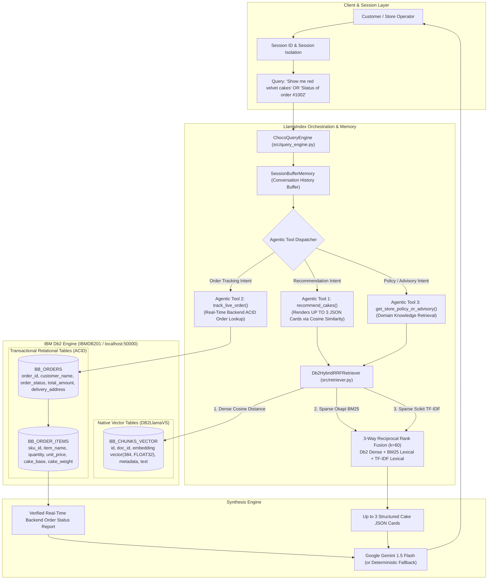

# System Architecture: BAKEBOX-AI — AUTONOMOUS AI Bakery Management AND CUSTOMER SUPPORT
## CHOCO AI: Advanced Hybrid RAG System on IBM Db2

**Event:** IBM Db2 TechX Summit 2026 • GL Bajaj Group of Institutions, Mathura (Db2Hack Dev Hacks)  
**Project Slug:** `submissions/bakebox-choco-ai`  
**Developer:** Ayush Dhangar ([@AYUSHDHANGAR](https://github.com/AYUSHDHANGAR)) · BTech CSE-AIML, 4th Year · AI Systems & Db2 Solutions Architect  
**Frameworks:** LlamaIndex, `llama-index-vector-stores-db2` (`DB2LlamaVS`), IBM Db2 (`ibm_db`, `ibm_db_dbi`), scikit-learn, Google Gemini

---

## 1. Dual-Perspective Architecture Overview

BAKEBOX-AI is designed to solve operational and communication challenges from **two perspectives simultaneously** — the customer and bakery management:

### Customer-Facing Pain Points Addressed:
- **Information Hesitation:** Customers frequently hesitate or feel awkward asking detailed questions about product specs, ingredients, allergen details, custom sizing, or base recommendations (e.g. Khoaa Eggless).
- **Operational & Tracking Blind Spots:** Real-time order status tracking, delivery updates, and fresh baking wait times are often locked behind phone calls or delayed support.
- **Customer Care Availability Gaps:** Live customer support drops off drastically after 9 PM, leaving late-night craving inquiries, urgent modifications, and order tracking unaddressed.

### Management & Business-Facing Pain Points Addressed:
- **Lost Sales & Conversion Bottlenecks:** Because human customer support agents are unavailable after hours or overwhelmed during peak times, bakeries fail to capture high-intent inquiries and late-night orders.
- **Missed Upselling Opportunities:** Static menus cannot proactively recommend matching cakes or suggest appropriate base customizers according to the customer's specific celebration.
- **Operational Inefficiencies:** Manually answering repetitive inquiries about baking wait times, patty reheating instructions, and order status drains staff bandwidth.

### How CHOCO AI Bridges Both Perspectives:
- **Instant 24/7 Access:** Available around the clock for late-night queries, live order tracking, and cake discovery.
- **Personalized Product Guidance:** Suggests up to 3 best-fit cakes based on semantic flavor preference and celebration type.
- **Agentic Ground-Truth Retrieval:** Direct transactional queries to IBM Db2 relational tables provide exact order status reports, eliminating hallucinations.
- **Bilingual Interaction:** Native support for bilingual Hindi and English phrasing to match local customer demographics.

---

## 2. High-Level System Architecture

BAKEBOX bridges traditional enterprise relational data with modern AI retrieval by leveraging **IBM Db2** simultaneously as:
1. **A Native High-Dimensional Vector Store:** Utilizing Db2 native `vector(384, FLOAT32)` columns and hardware-accelerated similarity search via `DB2LlamaVS`.
2. **A Relational Transactional Database:** Housing real-time customer orders, order line items, customized cake bases, and store operational agreements under ACID guarantees.



---

## 3. IBM Db2 Native Vector & Relational Database Schemas (DDL)

### 3.1 Official `DB2LlamaVS` Vector Table Schema
The table `BB_CHUNKS_VECTOR` is initialized and managed directly via `llama-index-vector-stores-db2`:

```sql
CREATE TABLE BB_CHUNKS_VECTOR (
    id VARCHAR(64) PRIMARY KEY NOT NULL,
    doc_id VARCHAR(64),
    embedding vector(384, FLOAT32),   -- IBM Db2 Native Vector Datatype
    node_info BLOB,
    metadata BLOB,
    text CLOB
);
```

### 3.2 Relational Transactional Tables (ACID Orders & Line Items)
```sql
CREATE TABLE BB_ORDERS (
    order_id INT NOT NULL PRIMARY KEY,
    user_id INT,
    customer_name VARCHAR(128) NOT NULL,
    customer_phone VARCHAR(32) NOT NULL,
    order_type VARCHAR(32) DEFAULT 'DELIVERY',
    order_status VARCHAR(32) DEFAULT 'BAKING',
    total_amount DECIMAL(10, 2) NOT NULL,
    delivery_address VARCHAR(512),
    special_notes VARCHAR(512),
    created_at TIMESTAMP DEFAULT CURRENT TIMESTAMP
);

CREATE TABLE BB_ORDER_ITEMS (
    item_id INT NOT NULL GENERATED ALWAYS AS IDENTITY (START WITH 1 INCREMENT BY 1) PRIMARY KEY,
    order_id INT NOT NULL,
    sku_id VARCHAR(64) NOT NULL,
    item_name VARCHAR(256) NOT NULL,
    quantity INT NOT NULL,
    unit_price DECIMAL(10, 2) NOT NULL,
    cake_base VARCHAR(64) DEFAULT 'Khoaa (Eggless)',
    cake_weight VARCHAR(32) DEFAULT '1kg',
    custom_message VARCHAR(256)
);
```

### 3.3 High-Performance Db2 B-Tree Indexes
```sql
-- Accelerated customer phone verification lookup
CREATE INDEX IDX_BB_ORDER_PHONE ON BB_ORDERS(customer_phone);

-- Accelerated order-to-items join performance
CREATE INDEX IDX_BB_ITEM_ORDER ON BB_ORDER_ITEMS(order_id);
```

### 3.4 In-Engine Vector Distance Search
When `BakeboxDb2VectorStore.query()` is invoked, IBM Db2 executes cosine distance calculations internally:
$$\text{Cosine Distance}(A, B) = 1 - \frac{A \cdot B}{\|A\|_2 \|B\|_2}$$

This in-engine hardware acceleration avoids fetching raw vectors to application memory, drastically reducing network I/O and latency.

---

## 4. Advanced 3-Way Hybrid RAG (Dense Db2 + BM25 + TF-IDF)

While dense vector search captures conceptual semantics, e-commerce queries often demand strict lexical precision (e.g. distinguishing `"1kg"` from `"0.5kg"` or `"Khoaa Eggless"` from standard cakes).

Our custom `Db2HybridRRFRetriever` fuses three independent retrieval channels:
1. **Dense Retrieval:** Native similarity ranking $R_{\text{dense}}$ from IBM Db2 `DB2LlamaVS`.
2. **Sparse Lexical Retrieval A (BM25):** Term frequency and document frequency ranking $R_{\text{bm25}}$ via Okapi BM25.
3. **Sparse Lexical Retrieval B (TF-IDF):** Sub-linear token matching $R_{\text{tfidf}}$ across product names and descriptions.

The reciprocal rank fusion score for document $d$ is computed as:
$$\text{RRF Score}(d) = \frac{1}{60 + R_{\text{dense}}(d)} + \frac{1}{60 + R_{\text{bm25}}(d)} + \frac{1}{60 + R_{\text{tfidf}}(d)}$$

Candidates are sorted by fused score, guaranteeing both conceptual relevance and exact keyword precision.

---

## 5. Session Isolation & Buffer Memory

To guarantee enterprise data privacy and conversation continuity:
- **`SessionBufferMemory`:** Each user interaction runs under a dedicated `session_id`.
- **Sliding-Window Buffer:** Conversation turns (user message, intent, assistant reply) are retained within an isolated sliding window, ensuring multi-turn dialogue context is maintained without cross-session contamination.

---

## 6. Real-Time Backend Order Status (Agentic Tool 2)

To eliminate AI hallucinations in customer service, CHOCO AI directly queries transactional relational tables when an order inquiry is detected:

```sql
SELECT O.order_id, O.customer_name, O.order_status, O.delivery_address, 
       I.item_name, I.cake_base, I.cake_weight, I.quantity
FROM BB_ORDERS O
JOIN BB_ORDER_ITEMS I ON O.order_id = I.order_id
WHERE O.order_id = ?;
```

If an active order is found in `BAKING` status at the Khatoti Kua kitchen, CHOCO returns exact status details from the database without invoking generative speculation.

---

## 7. Up to 3 Cake Cards Recommendation (Agentic Tool 1)

When recommendation intent is confirmed (e.g., *"show me red velvet cake"*), the engine enforces the **Up to 3 Cake Selection Rule**:
- Evaluates candidate cakes retrieved by the hybrid RRF engine against a cosine similarity threshold.
- Returns **up to 3** (not a hardcoded fixed 3) distinct cake cards that genuinely match the requested flavor and occasion.
- Each card contains verified database attributes: `sku_id`, `name`, `price`, `flavor`, `weight_kg`, and authentic image path.
- If only 1 or 2 cakes match the criteria, exactly 1 or 2 cards are returned, preserving catalog integrity.
