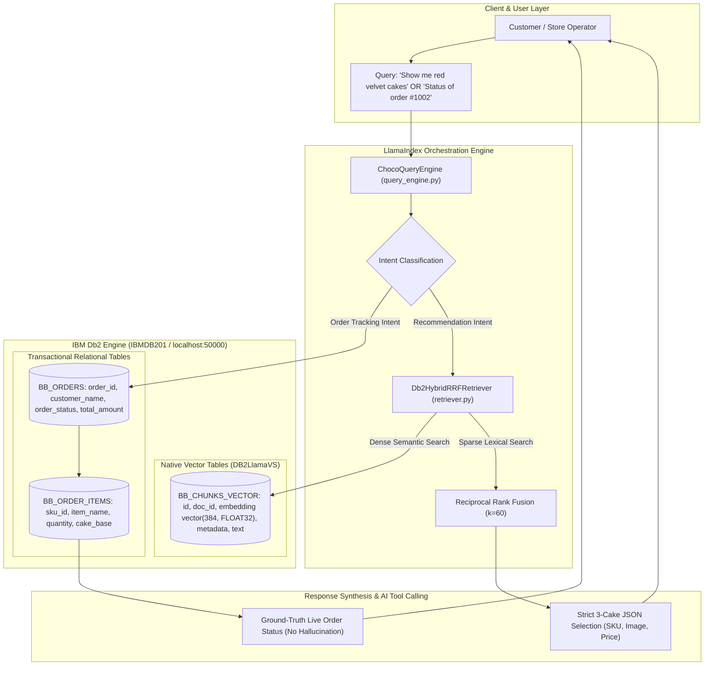

# System Architecture: BAKEBOX-AI (Autonomous AI Bakery Management & Customer Support)
## Autonomous AI Bakery Management Platform & Hybrid RAG System on IBM Db2

**Event:** IBM Db2 TechX Summit 2026 (Db2Hack Dev Hacks)  
**Project Slug:** `submissions/bakebox-choco-ai`  
**Developer:** Ayush Dhangar ([@AYUSHDHANGAR](https://github.com/AYUSHDHANGAR) • ayush.dhangar2024@glbajgroup.org)  
**IBM Db2 Environment:** IBM Db2 Community Edition (`IBMDB201` via IBM Db2 VS Code Extension & Docker, Port 50000)  
**Frameworks:** LlamaIndex, `llama-index-vector-stores-db2` (`DB2LlamaVS`), IBM Db2 (`ibm_db_dbi`)

---

## 1. High-Level Architecture Overview

BAKEBOX bridges traditional enterprise relational data with advanced AI retrieval by leveraging **IBM Db2** simultaneously as:
1. **A Native High-Dimensional Vector Store:** Utilizing Db2 v12.1.2+ native `vector(384, FLOAT32)` columns and hardware-accelerated similarity search via `DB2LlamaVS`.
2. **A Relational Transactional Database:** Housing real-time customer orders, order line items, customized cake bases, and store working agreements.



---

## 2. IBM Db2 Native Vector Column Utilization

### Official `DB2LlamaVS` Table Schema
The table `BB_CHUNKS_VECTOR` is initialized and managed directly via `llama-index-vector-stores-db2`:

```sql
CREATE TABLE BB_CHUNKS_VECTOR (
    id VARCHAR(64) PRIMARY KEY NOT NULL,
    doc_id VARCHAR(64),
    embedding vector(384, FLOAT32),   -- IBM Db2 Native 384-Dimensional Vector Datatype
    node_info BLOB,
    metadata BLOB,
    text CLOB
);
```

### In-Engine Vector Distance Search
When `BakeboxDb2VectorStore.query()` is invoked, IBM Db2 executes cosine distance calculations internally:
$$\text{Cosine Similarity}(A, B) = \frac{A \cdot B}{\|A\|_2 \|B\|_2}$$

This in-engine hardware acceleration avoids fetching raw vectors to application memory, drastically reducing network I/O and latency.

---

## 3. Hybrid Reciprocal Rank Fusion (RRF) Retrieval

While pure vector search captures general semantic intent, e-commerce queries often demand strict lexical precision (e.g. distinguishing `"1kg"` from `"0.5kg"` or `"Khoaa Eggless"` from standard cakes).

Our custom `Db2HybridRRFRetriever` solves this by fusing two independent retrieval channels:
1. **Dense Retrieval:** Native similarity ranking $R_{\text{dense}}$ from IBM Db2 `DB2LlamaVS`.
2. **Sparse Lexical Retrieval:** Exact token TF-IDF ranking $R_{\text{sparse}}$ across catalog titles and descriptions.

The reciprocal rank fusion score for document $d$ is computed as:
$$\text{RRF Score}(d) = \frac{1}{60 + R_{\text{dense}}(d)} + \frac{1}{60 + R_{\text{sparse}}(d)}$$

Candidates are sorted by fused score, guaranteeing both conceptual relevance and exact keyword precision.

---

## 4. Relational Transactional Ground Truth (`BB_ORDERS`)

To eliminate AI hallucinations in customer service, CHOCO AI directly queries transactional relational tables when an order inquiry is detected:

```sql
SELECT O.order_id, O.customer_name, O.order_status, O.delivery_address, 
       I.item_name, I.cake_base, I.cake_weight
FROM BB_ORDERS O
JOIN BB_ORDER_ITEMS I ON O.order_id = I.order_id
WHERE O.order_id = ?;
```

If an active order is found in `BAKING` status at the Khatoti Kua kitchen, CHOCO returns exact status details and suppresses product recommendation cards (`ui_cards: []`).

---

## 5. Strict 3-Cake Precision Recommendation (AI Tool Calling)

When recommendation intent is confirmed (e.g., *"show me red velvet cake"*), the engine enforces the **Strict 3-Cake Selection Rule**:
- Exactly 3 distinct cake cards matching the requested flavor and category are returned.
- Each card contains verified database attributes: `sku_id`, `name`, `price`, `flavor`, `weight_kg`, and authentic image path.
- The React / Next.js frontend renders these structured cards directly with an interactive **"Add to Cart"** action.
