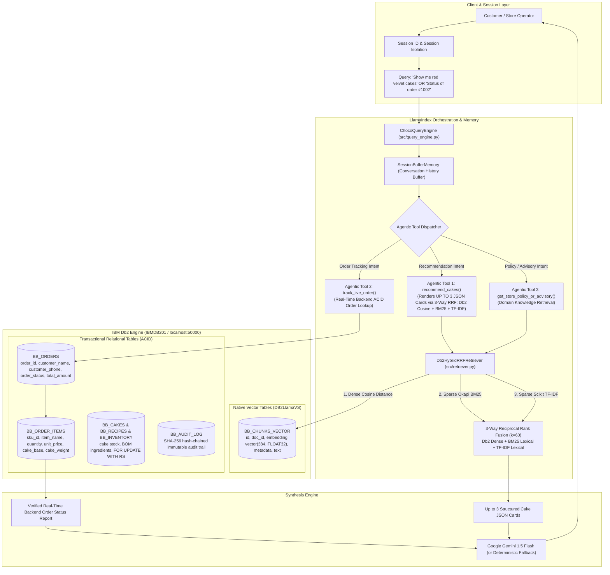
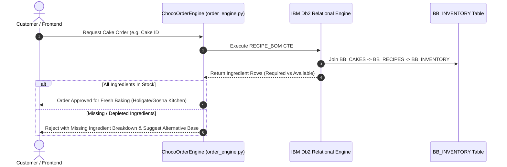

# System Architecture: BAKEBOX-AI — AUTONOMOUS AI Bakery Management AND CUSTOMER SUPPORT
## CHOCO AI: Advanced Hybrid RAG System on IBM Db2

**Event:** IBM Db2 TechX Summit 2026 • GL Bajaj Group of Institutions, Mathura (Db2Hack Dev Hacks)  
**Project Slug:** `submissions/bakebox-choco-ai`  
**Developer:** Ayush Dhangar ([@AYUSHDHANGAR](https://github.com/AYUSHDHANGAR)) · BTech CSE-AIML, 4th Year · AI Systems & Db2 Solutions Architect  
**Frameworks:** LlamaIndex, `llama-index-vector-stores-db2` (`DB2LlamaVS`), IBM Db2 (`ibm_db`, `ibm_db_dbi`), scikit-learn, Google Gemini

---

## 1. Dual-Perspective Architecture Overview

BAKEBOX-AI is designed to solve operational and communication challenges from **two perspectives simultaneously** — the customer and bakery management:

### Customer-Facing Pain Points Addressed:
- **Information Hesitation:** Customers frequently hesitate or feel awkward asking detailed questions about product specs, ingredients, allergen details, custom sizing, or base recommendations (e.g. Khoaa Eggless).
- **Operational & Tracking Blind Spots:** Real-time order status tracking, delivery updates, and fresh baking wait times are often locked behind phone calls or delayed support.
- **Customer Care Availability Gaps:** Live customer support drops off drastically after 9 PM, leaving late-night craving inquiries, urgent modifications, and order tracking unaddressed.

### Management & Business-Facing Pain Points Addressed:
- **Lost Sales & Conversion Bottlenecks:** Because human customer support agents are unavailable after hours or overwhelmed during peak times, bakeries fail to capture high-intent inquiries and late-night orders.
- **Missed Upselling Opportunities:** Static menus cannot proactively recommend matching cakes or suggest appropriate base customizers according to the customer's specific celebration.
- **Operational Inefficiencies:** Manually answering repetitive inquiries about baking wait times, patty reheating instructions, and order status drains staff bandwidth.

### How CHOCO AI Bridges Both Perspectives:
- **Instant 24/7 Access:** Available around the clock for late-night queries, live order tracking, and cake discovery.
- **Personalized Product Guidance:** Suggests up to 3 best-fit cakes based on semantic flavor preference and celebration type.
- **Agentic Ground-Truth Retrieval:** Direct transactional queries to IBM Db2 relational tables provide exact order status reports, eliminating hallucinations.
- **Bilingual Interaction:** Native support for bilingual Hindi and English phrasing to match local customer demographics.

---

## 2. High-Level System Architecture

BAKEBOX bridges traditional enterprise relational data with modern AI retrieval by leveraging **IBM Db2** simultaneously as:
1. **A Native High-Dimensional Vector Store:** Utilizing Db2 native `vector(384, FLOAT32)` columns and hardware-accelerated similarity search via `DB2LlamaVS`.
2. **A Relational Transactional Database:** Housing real-time customer orders, order line items, customized cake bases, and store operational agreements under ACID guarantees.



---

## 3. IBM Db2 Native Vector & Relational Database Schemas (DDL)

### 3.1 Official `DB2LlamaVS` Vector Table Schema
The table `BB_CHUNKS_VECTOR` is initialized and managed directly via `llama-index-vector-stores-db2`:

```sql
CREATE TABLE BB_CHUNKS_VECTOR (
    id VARCHAR(64) PRIMARY KEY NOT NULL,
    doc_id VARCHAR(64),
    embedding vector(384, FLOAT32),   -- IBM Db2 Native Vector Datatype
    node_info BLOB,
    metadata BLOB,
    text CLOB
);
```

### 3.2 Relational Transactional Tables (ACID Orders & Line Items)
```sql
CREATE TABLE BB_ORDERS (
    order_id INT NOT NULL PRIMARY KEY,
    user_id INT,
    customer_name VARCHAR(128) NOT NULL,
    customer_phone VARCHAR(32) NOT NULL,
    order_type VARCHAR(32) DEFAULT 'DELIVERY',
    order_status VARCHAR(32) DEFAULT 'BAKING',
    total_amount DECIMAL(10, 2) NOT NULL,
    delivery_address VARCHAR(512),
    special_notes VARCHAR(512),
    created_at TIMESTAMP DEFAULT CURRENT TIMESTAMP
);

CREATE TABLE BB_ORDER_ITEMS (
    item_id INT NOT NULL GENERATED ALWAYS AS IDENTITY (START WITH 1 INCREMENT BY 1) PRIMARY KEY,
    order_id INT NOT NULL,
    sku_id VARCHAR(64) NOT NULL,
    item_name VARCHAR(256) NOT NULL,
    quantity INT NOT NULL,
    unit_price DECIMAL(10, 2) NOT NULL,
    cake_base VARCHAR(64) DEFAULT 'Khoaa (Eggless)',
    cake_weight VARCHAR(32) DEFAULT '1kg',
    custom_message VARCHAR(256),
    CONSTRAINT FK_BB_ORDER FOREIGN KEY (order_id) REFERENCES BB_ORDERS(order_id) ON DELETE CASCADE
);
```

### 3.3 Operational Aggregation SQL View
```sql
CREATE VIEW V_ACTIVE_BAKERY_ORDERS AS
SELECT O.order_id, O.customer_name, O.order_status, O.total_amount, O.created_at,
       COUNT(I.item_id) AS total_items
FROM BB_ORDERS O
LEFT JOIN BB_ORDER_ITEMS I ON O.order_id = I.order_id
GROUP BY O.order_id, O.customer_name, O.order_status, O.total_amount, O.created_at;
```

### 3.4 High-Performance Db2 B-Tree Indexes
```sql
-- Accelerated customer phone verification lookup
CREATE INDEX IDX_BB_ORDER_PHONE ON BB_ORDERS(customer_phone);

-- Accelerated order-to-items join performance
CREATE INDEX IDX_BB_ITEM_ORDER ON BB_ORDER_ITEMS(order_id);

-- Accelerated SHA-256 audit chain traversal & recipe BOM joins
CREATE INDEX IDX_BB_AUDIT_PREV ON BB_AUDIT_LOG(prev_hash);
CREATE INDEX IDX_BB_AUDIT_CURR ON BB_AUDIT_LOG(current_hash);
CREATE INDEX IDX_BB_RECIPE_CAKE ON BB_RECIPES(cake_id);
```

### 3.5 Inventory, Recipe BOM, Audit Tables & Stored Procedure
```sql
CREATE TABLE BB_CAKES (
    cake_id INT NOT NULL PRIMARY KEY,
    name VARCHAR(256) NOT NULL,
    sku_id VARCHAR(64) NOT NULL,
    price DECIMAL(10, 2) NOT NULL,
    stock_qty INT NOT NULL DEFAULT 5,
    is_eggless_available SMALLINT DEFAULT 1
);

CREATE TABLE BB_INVENTORY (
    ingredient_id INT NOT NULL PRIMARY KEY,
    ingredient_name VARCHAR(128) NOT NULL,
    stock_qty DECIMAL(10, 2) NOT NULL DEFAULT 0.0,
    unit VARCHAR(32) DEFAULT 'kg'
);

CREATE TABLE BB_RECIPES (
    recipe_id INT NOT NULL GENERATED ALWAYS AS IDENTITY PRIMARY KEY,
    cake_id INT NOT NULL,
    ingredient_id INT NOT NULL,
    ingredient_name VARCHAR(128) NOT NULL,
    qty_needed DECIMAL(10, 2) NOT NULL,
    CONSTRAINT FK_RECIPE_CAKE FOREIGN KEY (cake_id) REFERENCES BB_CAKES(cake_id) ON DELETE CASCADE,
    CONSTRAINT FK_RECIPE_ING FOREIGN KEY (ingredient_id) REFERENCES BB_INVENTORY(ingredient_id) ON DELETE CASCADE
);

CREATE TABLE BB_AUDIT_LOG (
    log_id INT NOT NULL GENERATED ALWAYS AS IDENTITY PRIMARY KEY,
    session_id VARCHAR(128) NOT NULL,
    action_type VARCHAR(64) NOT NULL,
    payload CLOB NOT NULL,
    prev_hash VARCHAR(64) NOT NULL,
    current_hash VARCHAR(64) NOT NULL,
    created_at TIMESTAMP DEFAULT CURRENT TIMESTAMP
);

CREATE OR REPLACE PROCEDURE SP_RESERVE_CAKE_STOCK (
    IN p_cake_id INT,
    IN p_qty INT,
    OUT p_success INT
)
LANGUAGE SQL
BEGIN
    DECLARE v_current_stock INT DEFAULT 0;
    DECLARE EXIT HANDLER FOR NOT FOUND
    BEGIN
        SET p_success = 0;
        ROLLBACK;
    END;
    IF p_qty <= 0 THEN
        SET p_success = 0;
    ELSE
        SELECT stock_qty INTO v_current_stock
        FROM BB_CAKES WHERE cake_id = p_cake_id FOR UPDATE WITH RS;
        IF v_current_stock >= p_qty THEN
            UPDATE BB_CAKES SET stock_qty = stock_qty - p_qty
            WHERE cake_id = p_cake_id AND stock_qty >= p_qty;
            SET p_success = 1;
            COMMIT;
        ELSE
            SET p_success = 0;
            ROLLBACK;
        END IF;
    END IF;
END
```

### 3.6 Least-Privilege Db2 Roles (`sql/db2_least_privilege.sql`)
- `BAKEBOX_READER_ROLE` (`DB2_READONLY_USER`): Read-only `SELECT` on `BB_CHUNKS_VECTOR`, catalog, BOM, orders, and `V_ACTIVE_BAKERY_ORDERS`—used automatically by `BakeboxDb2VectorStore(..., readonly=True)` and `tool_track_live_order()` via `get_dbi_connection(readonly=True)`.
- `BAKEBOX_APP_ROLE` (`DB2_USER`): Inherits read access plus column-scoped `UPDATE (STOCK_QTY)` on `BB_CAKES`, `UPDATE (ORDER_STATUS)` on `BB_ORDERS`, `INSERT, SELECT` on `BB_AUDIT_LOG` (no `UPDATE`/`DELETE` to enforce append-only immutability), and `EXECUTE` on `SP_RESERVE_CAKE_STOCK`.

### 3.7 In-Engine Vector Distance Search
When `BakeboxDb2VectorStore.query()` is invoked, IBM Db2 executes cosine distance calculations internally:
$$\text{Cosine Distance}(A, B) = 1 - \frac{A \cdot B}{\|A\|_2 \|B\|_2}$$

This in-engine hardware acceleration avoids fetching raw vectors to application memory, drastically reducing network I/O and latency.

---

## 4. Advanced 3-Way Hybrid RAG (Dense Db2 + BM25 + TF-IDF)

While dense vector search captures conceptual semantics, e-commerce queries often demand strict lexical precision (e.g. distinguishing `"1kg"` from `"0.5kg"` or `"Khoaa Eggless"` from standard cakes).

Our custom `Db2HybridRRFRetriever` fuses three independent retrieval channels:
1. **Dense Retrieval:** Native similarity ranking $R_{\text{dense}}$ from IBM Db2 `DB2LlamaVS`.
2. **Sparse Lexical Retrieval A (BM25):** Term frequency and document frequency ranking $R_{\text{bm25}}$ via Okapi BM25.
3. **Sparse Lexical Retrieval B (TF-IDF):** Sub-linear token matching $R_{\text{tfidf}}$ across product names and descriptions.

The reciprocal rank fusion score for document $d$ is computed as:
$$\text{RRF Score}(d) = \frac{1}{60 + R_{\text{dense}}(d)} + \frac{1}{60 + R_{\text{bm25}}(d)} + \frac{1}{60 + R_{\text{tfidf}}(d)}$$

Candidates are sorted by fused score, guaranteeing both conceptual relevance and exact keyword precision.

---

## 5. Session Isolation & Buffer Memory

To guarantee enterprise data privacy and conversation continuity:
- **`SessionBufferMemory`:** Each user interaction runs under a dedicated `session_id`.
- **Sliding-Window Buffer:** Conversation turns (user message, intent, assistant reply) are retained within an isolated sliding window, ensuring multi-turn dialogue context is maintained without cross-session contamination.

---

## 6. Real-Time Backend Order Status (Agentic Tool 2)

To eliminate AI hallucinations and unauthorized order enumeration, CHOCO AI enforces two-factor verification (`order_id` + sanitized 10-digit customer phone suffix) via parameterized SQL with PII masking applied at the database boundary:

```sql
SELECT order_id, user_id, customer_name, customer_phone, order_type,
       order_status, total_amount, delivery_address, special_notes, created_at
FROM BB_ORDERS
WHERE order_id = ?
  AND RIGHT(REPLACE(REPLACE(customer_phone, ' ', ''), '-', ''), 10) = ?;
```

Items are retrieved via a second parameterized query against `BB_ORDER_ITEMS`, and `mask_customer_name`, `mask_phone_number`, and `mask_delivery_address` sanitize PII before returning to the LLM or HTTP layer.

---

## 7. Up to 3 Cake Cards Recommendation (Agentic Tool 1)

When recommendation intent is confirmed (e.g., *"show me red velvet cake"*), the engine enforces the **Up to 3 Cake Selection Rule**:
- Evaluates candidate cakes retrieved by the 3-Way Hybrid RRF engine against the relevance threshold (min_rrf_score >= 0.015).
- Returns **up to 3** (not a hardcoded fixed 3) distinct cake cards that genuinely match the requested flavor and occasion.
- Each card contains verified database attributes: `sku_id`, `name`, `price`, `flavor`, `weight_kg`, and authentic image path.
- If only 1 or 2 cakes match the criteria, exactly 1 or 2 cards are returned, preserving catalog integrity.

---

## 8. In-Database Bill-of-Materials (BOM) CTE (IBM Db2 LUW)

To automate kitchen inventory verification and prevent accepting orders for items that cannot be baked, BAKEBOX executes an in-engine **Bill-of-Materials (BOM) Common Table Expression (`WITH RECIPE_BOM`)** directly inside IBM Db2 LUW:

```sql
WITH RECIPE_BOM (CAKE_ID, INGREDIENT_NAME, REQUIRED_QTY, CURRENT_STOCK) AS (
    SELECT c.CAKE_ID, r.INGREDIENT_NAME, r.QTY_NEEDED, i.STOCK_QTY
    FROM BB_CAKES c
    JOIN BB_RECIPES r ON c.CAKE_ID = r.CAKE_ID
    JOIN BB_INVENTORY i ON r.INGREDIENT_ID = i.INGREDIENT_ID
    WHERE c.CAKE_ID = ?
)
SELECT INGREDIENT_NAME, REQUIRED_QTY, CURRENT_STOCK,
       CASE WHEN CURRENT_STOCK >= REQUIRED_QTY THEN 'IN_STOCK' ELSE 'OUT_OF_STOCK' END AS AVAILABILITY
FROM RECIPE_BOM;
```



---

## 9. ACID Row-Level Concurrency & Stored Procedure (`WITH RS` & `callproc`)

To eliminate race-condition overselling when simultaneous buyers target the last remaining cake in inventory, BAKEBOX supports both Db2's native **Read Stability (`WITH RS`)** row lock (`reserve_cake_stock_atomic`) and the Db2 SQL PL stored procedure **`SP_RESERVE_CAKE_STOCK`** invoked via PEP 249 `cursor.callproc()`:

```mermaid
sequenceDiagram
    autonumber
    actor BuyerA as Buyer A (Web App)
    actor BuyerB as Buyer B (Mobile App)
    participant OrderEngine as Order & Concurrency Engine
    participant Db2 as IBM Db2 (BB_CAKES)

    Note over BuyerA,BuyerB: Stock = 1 (Last Cake in Stock)
    BuyerA->>OrderEngine: Order Cake #2 (Qty: 1)
    BuyerB->>OrderEngine: Order Cake #2 (Qty: 1)
    
    OrderEngine->>Db2: Thread 1: SELECT STOCK_QTY FROM BB_CAKES WHERE CAKE_ID=2 FOR UPDATE WITH RS
    Note over Db2: Row Locked exclusively by Thread 1
    OrderEngine->>Db2: Thread 2: SELECT STOCK_QTY ... FOR UPDATE WITH RS (Blocked / Leased)
    
    Db2-->>OrderEngine: Thread 1 reads Stock = 1
    OrderEngine->>Db2: Thread 1: UPDATE BB_CAKES SET STOCK_QTY = 0; COMMIT;
    Note over Db2: Row Lock Released
    
    Db2-->>OrderEngine: Thread 2 acquires lock, reads Stock = 0
    OrderEngine->>Db2: Thread 2: ROLLBACK;
    
    OrderEngine-->>BuyerA: Order #1003 Confirmed (Success)
    OrderEngine-->>BuyerB: Sold Out (Safely Rejected, Zero Overselling)
```

---

## 10. Cryptographic SHA-256 Hash-Chained Audit Trail (`BB_AUDIT_LOG`)

Every critical business action (order placement, stock reservation, refund approval, and cancellation) is permanently recorded in a tamper-evident audit table inside IBM Db2. `append_audit_log` serializes concurrent writers using `_AUDIT_CHAIN_LOCK` plus `LOCK TABLE BB_AUDIT_LOG IN EXCLUSIVE MODE` and queries the tail hash via `ORDER BY LOG_ID DESC FETCH FIRST 1 ROW ONLY` inside a single atomic transaction to prevent hash-chain forks:

$$\text{Current Hash} = \text{SHA256}(\text{Prev Hash} \,\|\, \text{session\_id} \,\|\, \text{action\_type} \,\|\, \text{canonical\_payload\_json} \,\|\, \text{timestamp})$$

```mermaid
flowchart LR
    subgraph Genesis ["Genesis Block"]
        G_Prev["Prev: 00000000...000"]
        G_Action["Action: GENESIS_INIT"]
        G_Hash["Current Hash: H(0)"]
    end

    subgraph Block1 ["Audit Block #1: Order Created"]
        B1_Prev["Prev: H(0)"]
        B1_Action["Action: ORDER_PLACED (#1002)"]
        B1_Hash["Current Hash: H(1)"]
    end

    subgraph Block2 ["Audit Block #2: Stock Locked"]
        B2_Prev["Prev: H(1)"]
        B2_Action["Action: STOCK_RESERVED (Cake #1)"]
        B2_Hash["Current Hash: H(2)"]
    end

    subgraph Block3 ["Audit Block #3: Refund Claim"]
        B3_Prev["Prev: H(2)"]
        B3_Action["Action: REFUND_APPROVED (#1002)"]
        B3_Hash["Current Hash: H(3)"]
    end

    Genesis --> Block1 --> Block2 --> Block3
```



### Forensic Verification Routine (`verify_audit_chain`)
The system provides `verify_audit_chain(conn)` which traverses all rows in `BB_AUDIT_LOG`:
- Recalculates the SHA-256 digest of every payload.
- Confirms pointer continuity ($\text{Prev Hash}_n == \text{Current Hash}_{n-1}$).
- If an unauthorized database modification occurs, the engine flags tampering, pinpoints the compromised row ID, and reports hash divergence.

---

## 11. Self-Contained Production FastAPI & Security Architecture

The REST API layer (`src/api.py`) and core engine (`src/query_engine.py`) expose OpenAPI endpoints with defense-in-depth protections:
- `GET /` & `GET /api/health`: System health, Db2 mode (Live / Mock), active catalog count, and Db2 capabilities.
- `POST /api/chat`: Natural language chat using request-scoped `ContextVar` tool-call isolation, conversation buffer memory, shared `check_prompt_security()` guardrails, and XML-delimited prompt separation (`<conversation_history_readonly>`, `<customer_query_untrusted>`).
- `GET /api/cakes/search`: Input-validated 3-Way RRF product retrieval with eggless filtering.
- `GET /api/orders/{id}`: Real-time order tracking with two-factor phone verification and automated PII masking.
- `POST /api/orders/{id}/refund`: Two-factor phone-verified Happiness Guarantee evaluation against Db2 order logs with deterministic connection cleanup and explicit CORS origin allowlisting (`CORS_ALLOW_ORIGINS`).
