# Verification, Screenshots & Visual Proof: BAKEBOX Choco AI

This directory documents execution traces, architectural flow, and visual verification screenshots demonstrating the real-world deployment, IBM Db2 database integration, and autonomous customer support capabilities of **BAKEBOX - CHOCO AI**.

A full interactive video walkthrough demonstrating the live queries, order tracking, and cake recommendation cards is available on YouTube:  
**[Watch Video Walkthrough (YouTube)](https://youtu.be/NLrRq6FX358?si=oZM-EGpaBt4AOSVM)**

---

## 1. Visual Verification & Production Screenshots

### 1.1 IBM Db2 Live Database & Vector Store Verification
#### `01_ibm_db2_extension_tables.png`
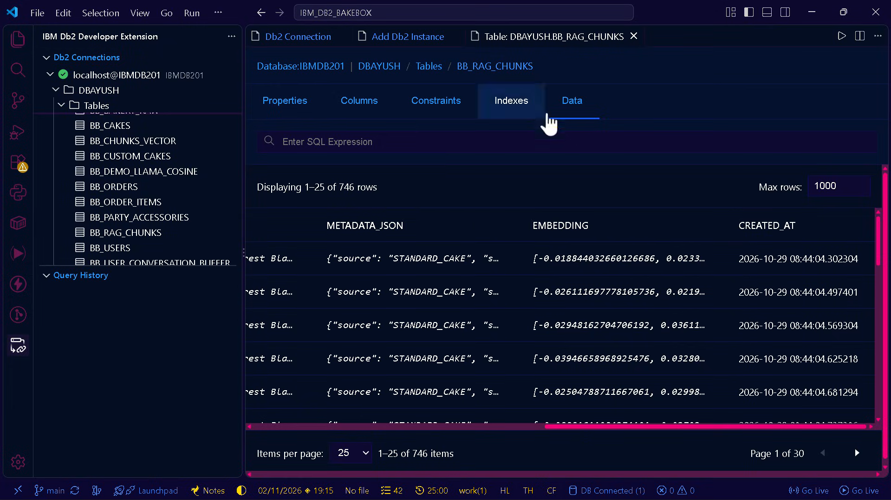

> [!NOTE]
> **Production Deployment vs Evaluation Scope:**  
> Screenshot `01_ibm_db2_extension_tables.png` demonstrates the complete enterprise schema from the live deployed Mathura storefront (demonstrated in our YouTube walkthrough).
> For lightweight, zero-bloat hackathon reproducibility, this submission package (`submissions/bakebox-choco-ai/`) isolates the core evaluated microservices: `BB_CHUNKS_VECTOR` (Db2 native vector search via `DB2LlamaVS` + BSON metadata pushdown), `BB_ORDERS` & `BB_ORDER_ITEMS` (relational ACID tables with `FK_BB_ORDER ON DELETE CASCADE`), `BB_CAKES` & `BB_INVENTORY`/`BB_RECIPES`/`BB_INGREDIENT_COMPONENTS` (Recursive BOM CTE + `SP_RESERVE_CAKE_STOCK`), `BB_AUDIT_LOG` (SHA-256 hash chain), `BB_USER_CONVERSATION_BUFFER` (Db2 session buffer), and `V_ACTIVE_BAKERY_ORDERS` / `V_MASKED_BAKERY_ORDERS` SQL views, backed by datasets in `data/`.

- **Component:** IBM Db2 Developer Extension in Visual Studio Code.
- **Connection:** Live instance connected at `localhost@IBMDB201` under schema `DBAYUSH`.
- **Database Tables Verified:**
  - `BB_CAKES`: Full product catalog table containing 558+ live bakery items.
  - `BB_CHUNKS_VECTOR`: Dense vector table created via `DB2LlamaVS` for native vector search.
  - `BB_CUSTOM_CAKES`: User-customized cake design records.
  - `BB_DEMO_LLAMA_COSINE`: LlamaIndex cosine similarity index table.
  - `BB_ORDERS`: Relational order table storing order statuses, customer details, and kitchen dispatch data.
  - `BB_ORDER_ITEMS`: Relational line items associated with each order.
  - `BB_PARTY_ACCESSORIES`: Bakery party supplies and add-ons.
  - `BB_RAG_CHUNKS`: Hybrid RAG knowledge base table storing dense vector embeddings, metadata JSON, and chunk text.
  - `BB_USERS`: Registered bakery customer profiles and authentication credentials.
  - `BB_USER_CONVERSATION_BUFFER`: Strict session-isolated conversation history buffer.
- **Data Viewer:** Highlights active records in `DBAYUSH.BB_RAG_CHUNKS` with `METADATA_JSON`, vector embeddings, and real-time timestamps.

---

### 1.2 Customer Storefront & Catalog Experience
#### `07_storefront_catalog_overview.png`
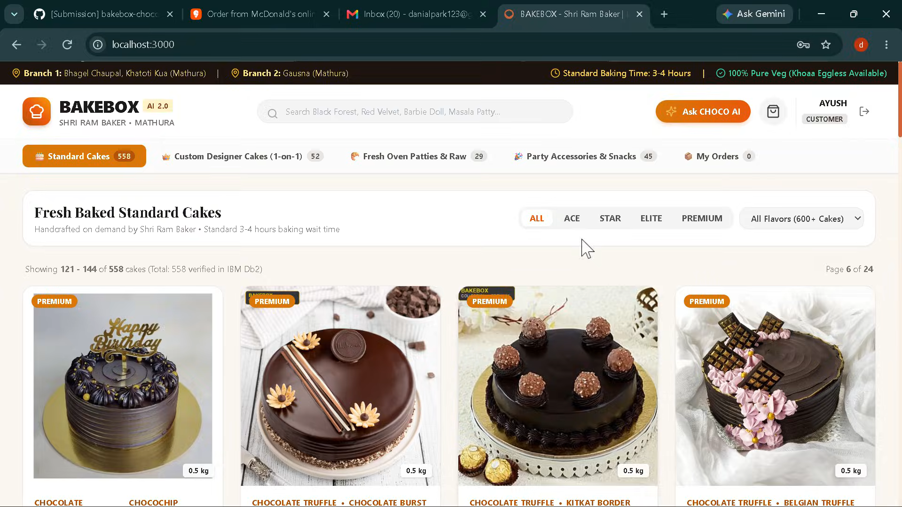
- **Component:** BAKEBOX AI 2.0 Customer Storefront & Header.
- **Operational Metrics:** Real-time branch indicators (*Branch 1: Bhagel Chaupal, Khatoti Kua (Mathura) | Branch 2: Gausna (Mathura)*), 3-4 hours baking wait time badge, and 100% Pure Veg (Khoaa Eggless Available) badge.
- **Catalog Navigation:** Instant category filters (*Standard Cakes (558), Custom Designer Cakes (52), Fresh Oven Patties (29), Party Accessories (45)*).
- **Cake Cards:** Shows standard cake tier cards (Premium Chocolate Truffle, Kitkat Border, Belgian Truffle) with dynamic weights and instant actions.

#### `09_product_catalog_grid_actions.png`
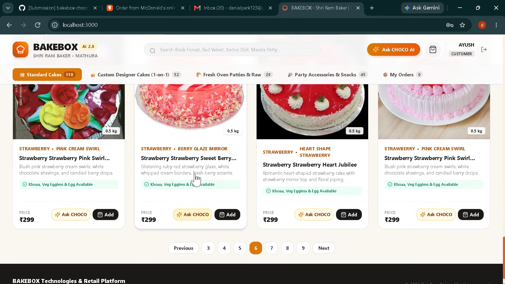
- **Component:** Strawberry Collection Catalog Grid with Direct Actions.
- **Features:** Shows specific cake metadata (*Khoaa, Veg Eggless & Egg Available, Pricing at ₹299*), pagination across 558 cakes, and 1-click **Ask CHOCO** & **Add** buttons on every card.

---

### 1.3 Autonomous Master Baker & AI Advisory (CHOCO AI)
#### `10_ask_choco_contextual_query.png`
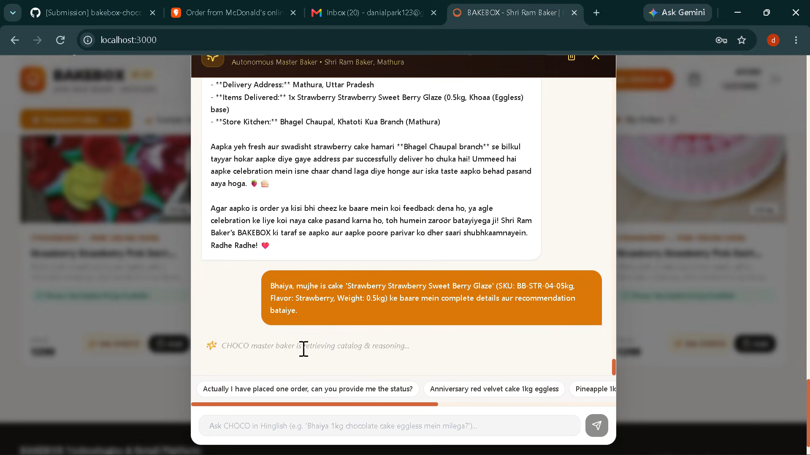
- **Component:** 1-Click Contextual Cake Advisory Trigger.
- **Action:** Clicking "Ask CHOCO" on a cake card auto-injects the exact cake name, SKU ID (`BB-STR-04-05kg`), flavor, and weight into the chat session, displaying the real-time reasoning state: *"CHOCO master baker is retrieving catalog & reasoning..."*.

#### `11_choco_master_baker_recommendation.png`
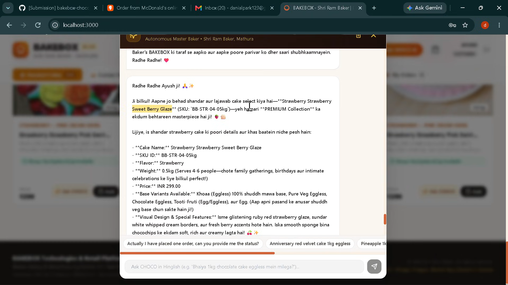
- **Component:** CHOCO AI Precision Recommendation Response.
- **Output:** Generates a warm, bilingual (Hinglish/English) recommendation detailing SKU verification, recommended party size (4-6 people), transparent pricing (₹299.00), base customizations (100% Pure Khoaa/Mawa eggless base), and visual design features directly retrieved from Db2 hybrid RAG.

---

### 1.4 Live Order Tracking & Transactional Db2 Queries
#### `02_choco_order_status_confirmed.png`
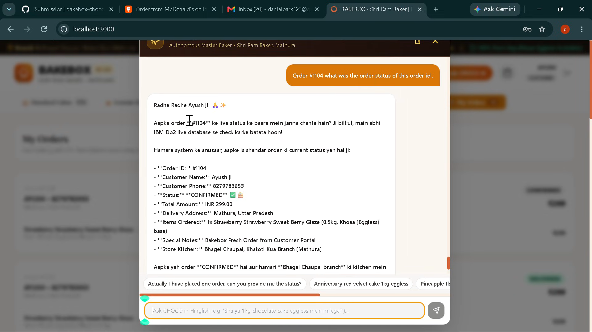
- **Component:** Live Order Tracking via Agentic Tool Calling.
- **User Query:** *"Order #1104 what was the order status of this order id ."*
- **Database Query Execution:** CHOCO AI queries `BB_ORDERS` and `BB_ORDER_ITEMS` in real time and reports:
  - **Order ID:** #1104
  - **Customer Name:** Ayush ji (Phone: 8279783653)
  - **Status:** `CONFIRMED`
  - **Items Ordered:** 1x Strawberry Sweet Berry Glaze (0.5kg, Khoaa Eggless base)
  - **Kitchen Dispatch:** Bhagel Chaupal, Khatoti Kua Branch (Mathura).

#### `03_choco_order_status_delivered.png`
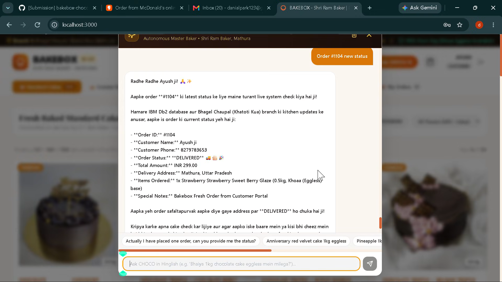
- **Component:** Real-Time Order Lifecycle Updates.
- **User Query:** *"Order #1104 new status"*
- **Resolution:** Live synchronization with IBM Db2 reflects status change from `CONFIRMED` to `DELIVERED`, confirming safe hand-off to the customer's delivery address in Mathura.

---

### 1.5 Intelligent Customer Care & Policy Resolution
#### `04_choco_happiness_guarantee_support.png`
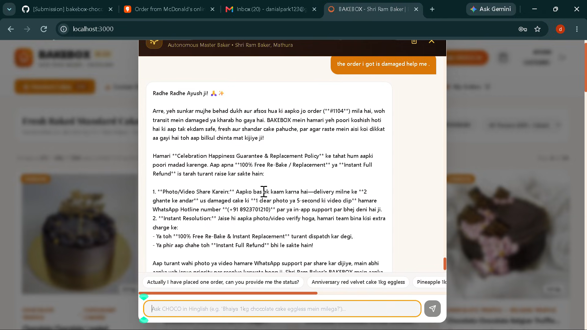
- **Component:** Damaged Order Resolution & Emotional Alignment.
- **User Query:** *"the order i got is damaged help me ."*
- **Policy Retrieval:** CHOCO AI instantly references the bakery's *Celebration Happiness Guarantee & Replacement Policy* from unstructured document embeddings in Db2 to offer 100% Free Re-bake or Instant Full Refund without human escalation.

#### `08_refund_replacement_resolution.png`
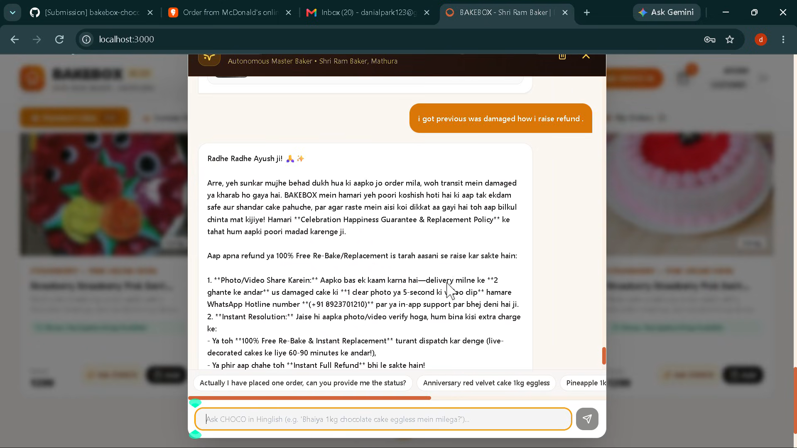
- **Component:** Refund Procedure Guidance.
- **User Query:** *"i got previous was damaged how i raise refund ."*
- **Resolution:** Step-by-step instructions (photo verification within 2 hours via WhatsApp helpline `+91 8923701210`) with priority re-baking dispatch within 60-90 minutes.

---

### 1.6 Role-Based Access Control & Operations Management
#### `05_bakebox_auth_role_modal.png`
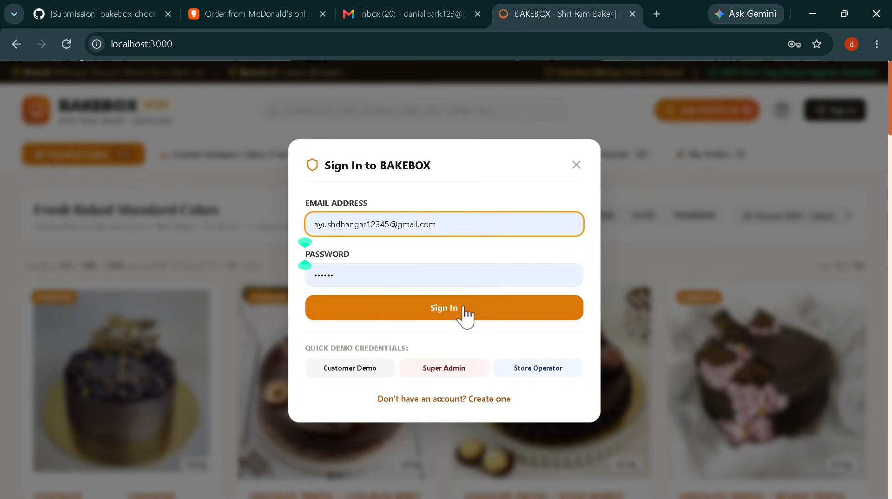
- **Component:** Multi-Role Authentication Modal.
- **Roles:** Demonstrates role-based access control with one-click demo credentials for **Customer Demo**, **Super Admin**, and **Store Operator**.

#### `06_operator_login.png`
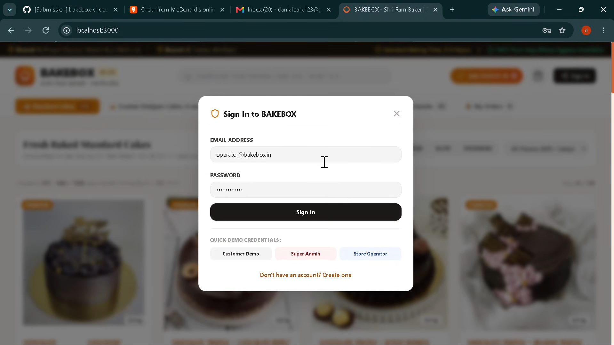
- **Component:** Store Operator Authentication.
- **Role:** Authenticates operator account (`operator@bakebox.in`) to manage kitchen workflows, live baking queues, and branch dispatch synchronization.

---

## 2. Terminal Verification: Db2 Vector & Relational Ingestion
```text
==================================================================
BAKEBOX CHOCO AI — IBM Db2 DATA INGESTION PIPELINE
==================================================================
Step 1: Setting up IBM Db2 Relational Schema, Indexes, Views & Stored Procedure...
  -> Table BB_ORDERS created successfully.
  -> Table BB_ORDER_ITEMS created successfully.
  -> Table BB_CAKES created successfully.
  -> Table BB_INVENTORY created successfully.
  -> Table BB_RECIPES created successfully.
  -> Table BB_INGREDIENT_COMPONENTS created successfully.
  -> Table BB_AUDIT_LOG created successfully.
  -> Table BB_USER_CONVERSATION_BUFFER created successfully.
  -> View V_ACTIVE_BAKERY_ORDERS created successfully.
  -> View V_MASKED_BAKERY_ORDERS created successfully.
  -> Index IDX_BB_ORDER_PHONE created successfully.
  -> Stored Procedure SP_RESERVE_CAKE_STOCK created successfully.

Step 2: Loading embedding engine 'BAAI/bge-small-en-v1.5'...

Step 3: Generating 384-dimensional dense vectors for knowledge corpus...
  -> Generated embeddings for 15 knowledge nodes.

Step 4: Ingesting vectors into 'BB_CHUNKS_VECTOR'...
  -> Ingestion complete!
```

---

## 3. Terminal Verification: Agentic Query Engine & 2FA Privacy Flow
```text
=== SESSION 1: Recommendation ===
INTENT: CAKE_RECOMMENDATION | CARDS: 3
Radhe Radhe ji! Shri Ram Baker's BAKEBOX mein aapka swagat hai!

Aapki celebration ke liye hamare paas 3 fresh live options available hain:
• Red Velvet Berry Fantasy (₹649.0, 1.0kg)
• Red Velvet Heart Love Affair (₹649.0, 1.0kg)
• Red Velvet Crimson Crumb Crown (₹649.0, 1.0kg)

Hamare paas 100% Pure Veg (Khoaa Eggless) aur Egg-based dono base options available hain. Aap apni dietary preference ke mutabiq order customize kar sakte hain (fresh baking wait time: 3-4 ghante)!

=== SESSION 2: Order Challenge ===
INTENT: ORDER_AUTH_REQUIRED | CARDS: 0
Radhe Radhe ji! Customer data privacy & security policy ke mutabiq, Order #1002 ka live status access karne ke liye kripya apna registered 10-digit mobile number sath mein provide karein.

=== SESSION 2: Authenticated Tracking ===
INTENT: ORDER_TRACKING | CARDS: 0
Radhe Radhe ji! Shri Ram Baker's BAKEBOX mein aapka swagat hai!

Humne aapke order ki live details IBM Db2 se verify kar li hain:
• Order ID: #1002 (Customer: R**** S*****)
• Status: BAKING
• Items: 1x Red Velvet Heart Love Affair (1.0kg, Khoaa (Eggless))
• Delivery Destination: ***, Mathura, UP (Confidential)

Shri Ram Baker par har cake order par live fresh bake hota hai (standard 3-4 ghante wait time) to ensure 100% purity and taste!
```

---

## 4. Automated Test Suite Execution
```bash
python -m unittest discover -s submissions/bakebox-choco-ai/tests -v
```
- **Total Suites Executed:** 6 test modules (`test_audit_chain.py`, `test_guardrails_and_api.py`, `test_order_concurrency.py`, `test_retrieval.py`, `test_rrf_fusion.py`, `test_session_memory.py`).
- **Result:** `Ran 73 tests in ~21s — OK` (covering ACID row locks, single-UOW rollback integrity, SHA-256 audit tampering & concurrency, Gemini 1.5 Flash 5-tool schemas & isolation, 3-Way RRF, Hinglish CRAG, Self-RAG, FastAPI `TestClient` routes, brute-force 2FA lockout, and prompt-injection defense).
