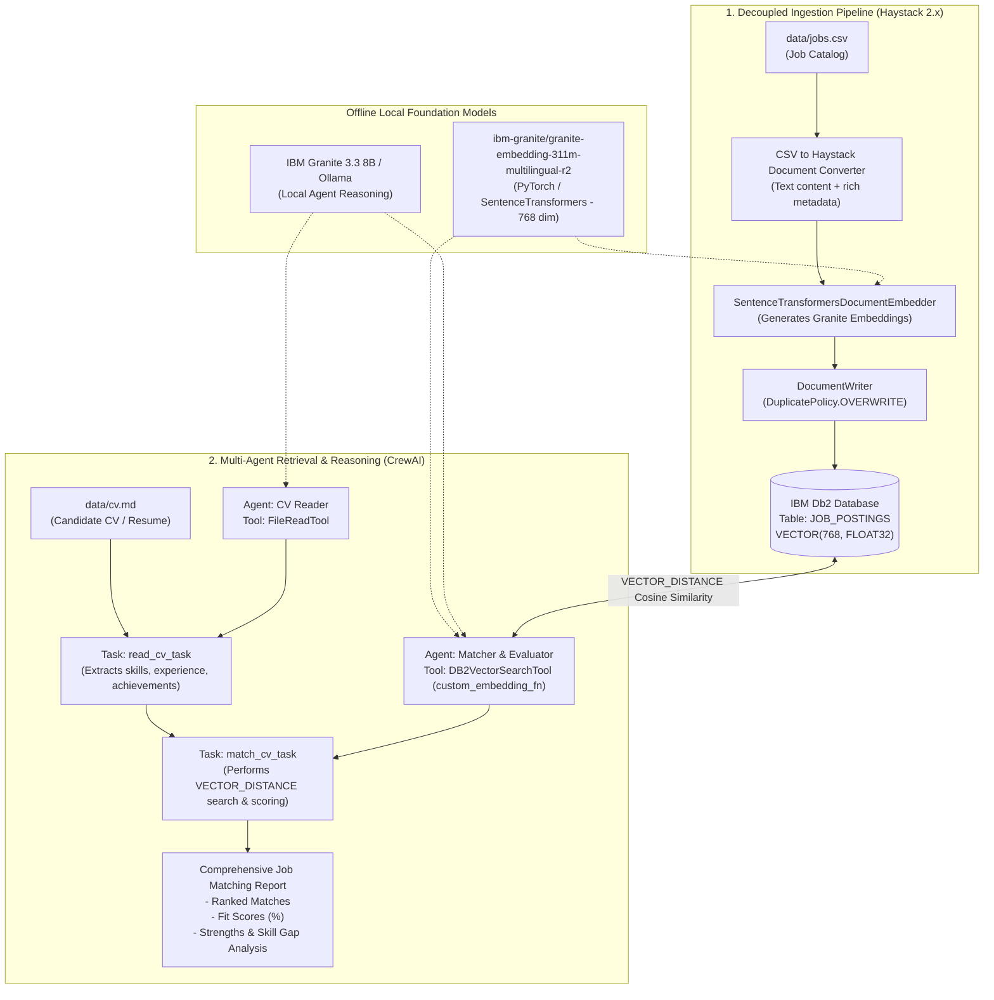

# System Architecture: CrewAI + IBM Db2 Vector Search Profile Matcher

## Overview
This document outlines the architecture, component breakdown, data flow, database schema, and privacy-first design of the Candidate Profile-to-Job Matching system built on **IBM Db2**, **CrewAI**, and **Haystack 2.x** with local **IBM Granite embeddings**.

---

## Architecture Diagram



---

## Component Breakdown

### 1. Ingestion Subsystem (Haystack 2.x)
- **`src/ingestion/ingest_jobs_haystack.py`**:
  - Independent, decoupled ETL pipeline.
  - Converts structured CSV job records into Haystack `Document` objects with rich metadata.
  - Uses `SentenceTransformersDocumentEmbedder` to generate 768-dimensional dense vectors using `ibm-granite/granite-embedding-311m-multilingual-r2`.
  - Persists documents and vectors directly into `IBMDb2DocumentStore`.

### 2. Multi-Agent Orchestration Subsystem (CrewAI)
- **`src/match_to_proposal/crew.py`**:
  - Defines the sequential multi-agent crew:
    - **`cv_reader`**: Employs `FileReadTool` to ingest and parse markdown/text candidate resumes.
    - **`matcher`**: Employs `DB2VectorSearchTool` configured with `local_embedding_function` to query IBM Db2 via cosine vector similarity.
- **`src/match_to_proposal/config/agents.yaml`** & **`tasks.yaml`**:
  - Declarative configuration for agent roles, goals, backstories, task descriptions, and structured output formats.

### 3. Shared Utilities Layer
- **`src/utils/embeddings.py`**:
  - Singleton loader for the local IBM Granite embedding model.
  - Provides `local_embedding_function(text: str) -> List[float]` compatible with CrewAI vector tools.
- **`src/utils/db2_config.py`**:
  - Unified configuration helper reading either `DB2_CONNECTION_STRING` or individual `DB2_*` parameters.
  - Includes `DB2JSONEncoder` memoryview handling to serialize Db2 CLOB data into JSON.

---

## Data Flow

1. **Job Vectorization**:
   - `data/jobs.csv` $\rightarrow$ Haystack Pipeline $\rightarrow$ Local Granite Embedder (768-dim) $\rightarrow$ IBM Db2 `JOB_POSTINGS` table.
2. **Candidate Analysis**:
   - Candidate resume (`data/cv.md`) is ingested by the `cv_reader` agent $\rightarrow$ structured skill summary is produced.
3. **Semantic Vector Search**:
   - The `matcher` agent formulates semantic search queries $\rightarrow$ `local_embedding_function` computes query vector locally $\rightarrow$ `DB2VectorSearchTool` executes `VECTOR_DISTANCE` query in IBM Db2 $\rightarrow$ Top-$K$ relevant job postings are returned.
4. **Agentic Evaluation & Synthesis**:
   - The `matcher` agent compares candidate capabilities against the retrieved jobs, calculating alignment percentages, highlighting core strengths, identifying growth areas, and producing the final formatted report.

---

## IBM Db2 Schema & Storage Design

```sql
CREATE TABLE JOB_POSTINGS (
    ID VARCHAR(128) NOT NULL PRIMARY KEY,
    CONTENT CLOB,
    DATAFRAME CLOB,
    BLOB_DATA BLOB,
    BLOB_MIME_TYPE VARCHAR(128),
    META CLOB,
    EMBEDDING VECTOR(768, FLOAT32)
);
```

### Search Operation:
```sql
SELECT ID, CONTENT, META, VECTOR_DISTANCE(EMBEDDING, ?, 'COSINE') AS DISTANCE
FROM JOB_POSTINGS
ORDER BY DISTANCE ASC
FETCH FIRST 5 ROWS ONLY;
```

---

## Security & Privacy Architecture
- **Zero Cloud Leakage for Embeddings**: Resume data and job postings are embedded entirely on local CPU/GPU hardware using open-source IBM Granite models.
- **Safe Secrets Handling**: No database credentials, API tokens, or server IPs are hardcoded. All parameters are injected at runtime via environment variables.
- **SQL Parameterization**: Vector queries and search queries use parameterized statements through `ibm_db` and the official `DB2VectorSearchTool`.
